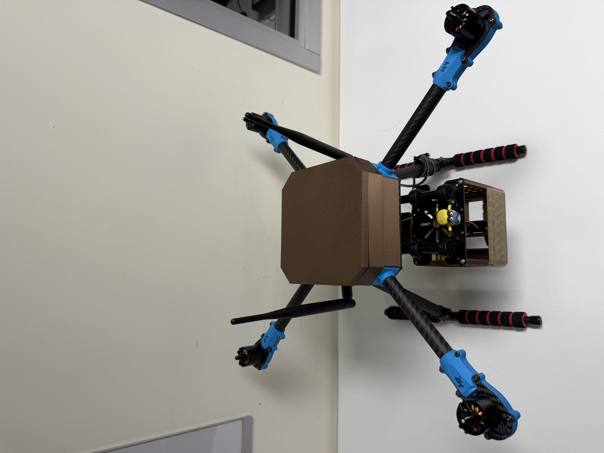
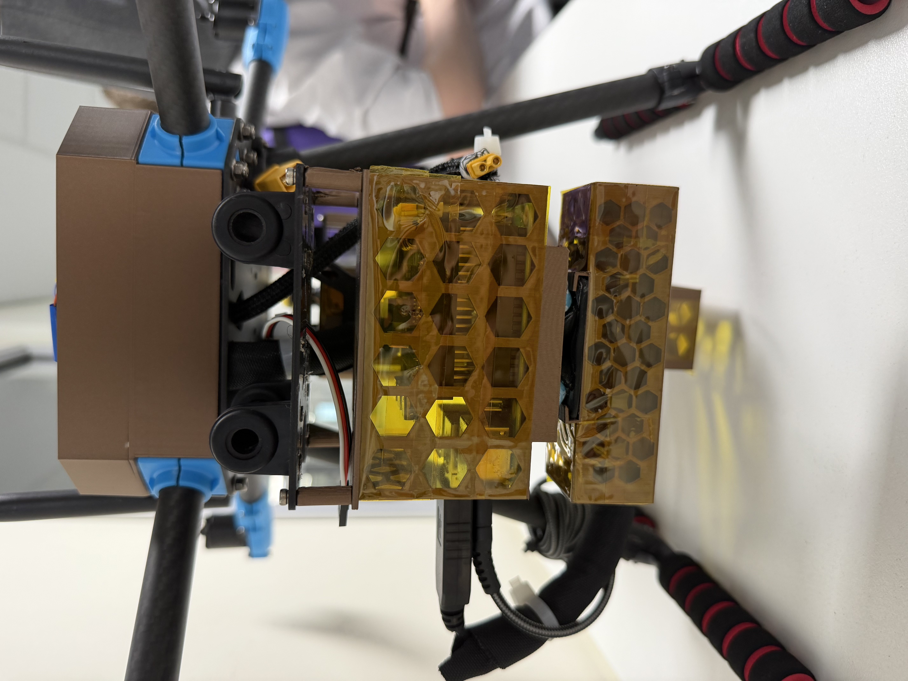
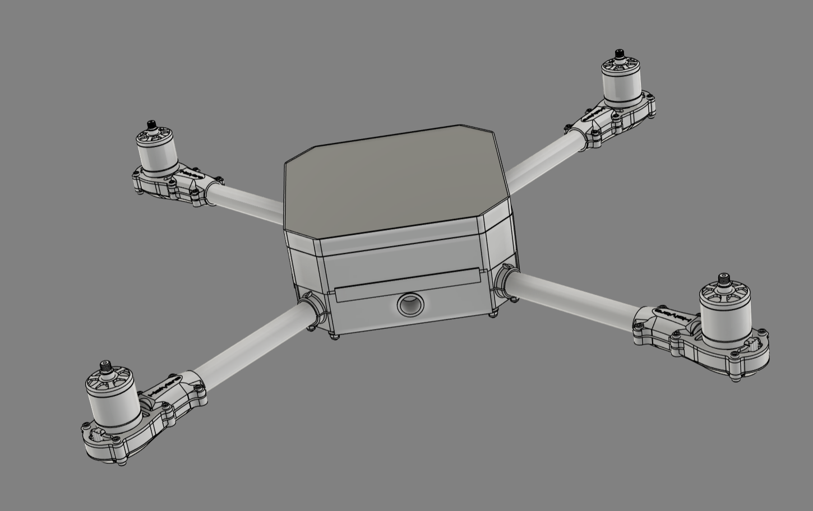
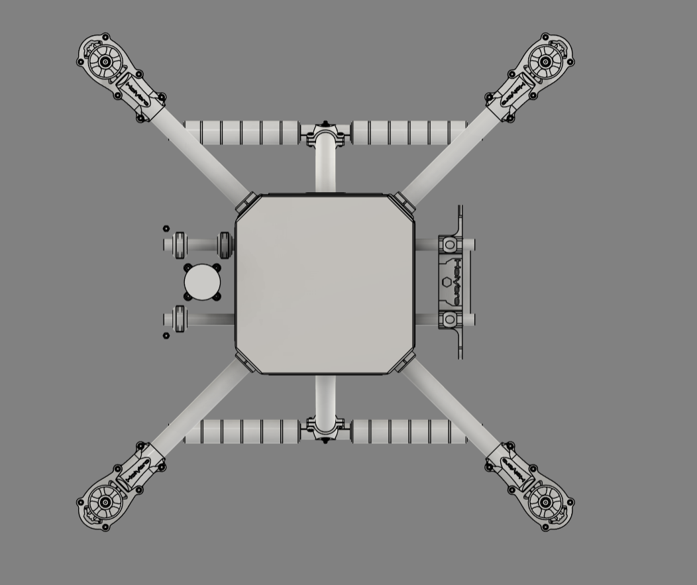
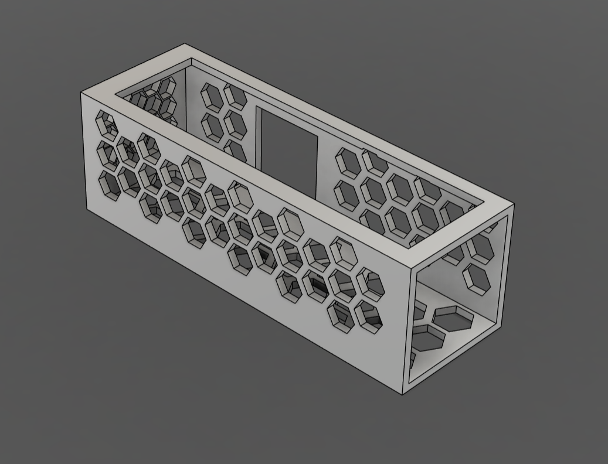
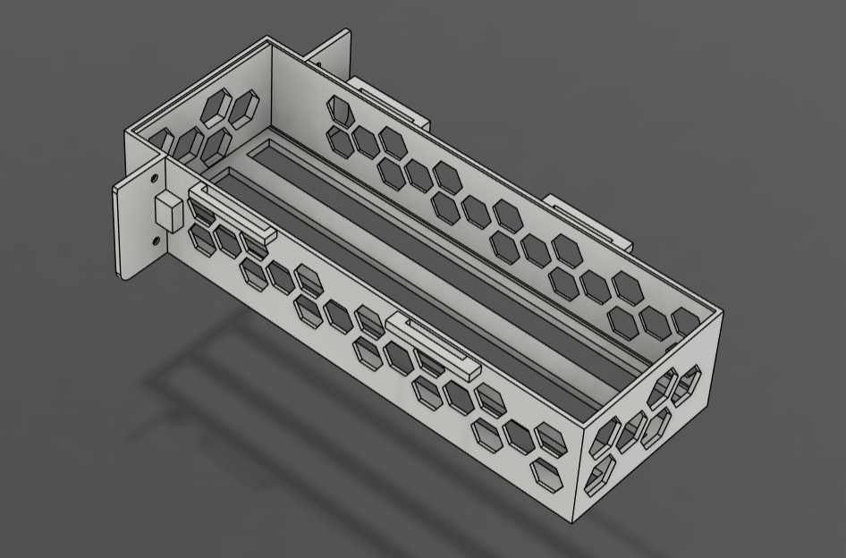
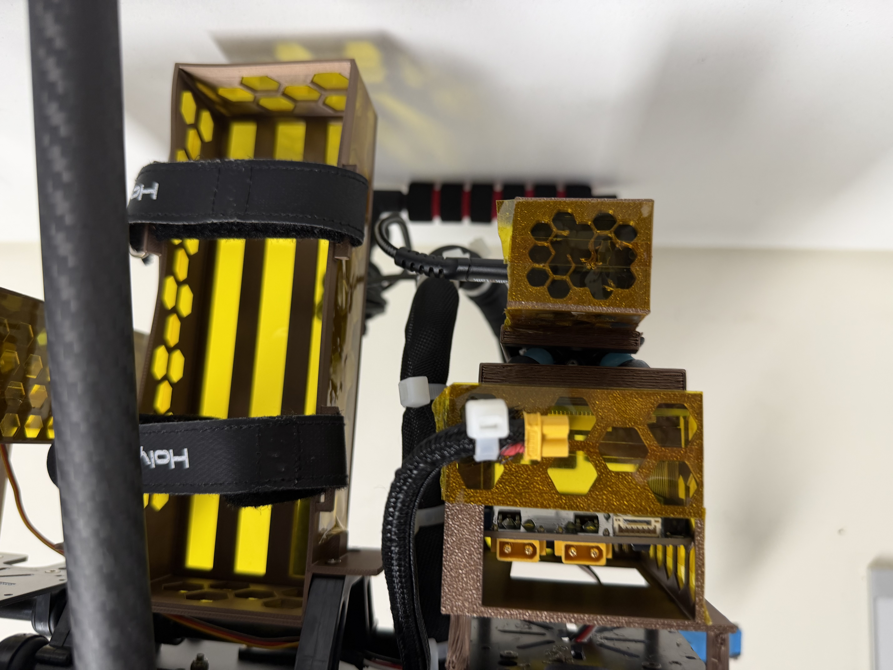
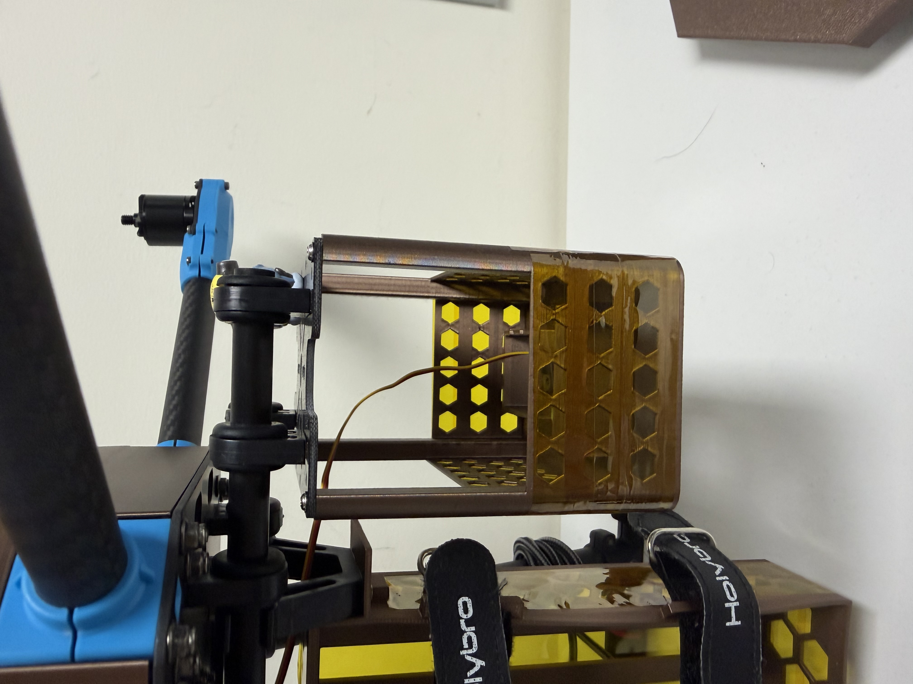

# EGH450 Advanced Uncrewed Aircraft Systems (High Distinction)

**Airframe, power and propulsion subsystem work for a quadrotor uncrewed aircraft.**

Project artefacts from EGH450 at the Queensland University of Technology (QUT): the CAD for the
3D-printed payload and electronics enclosures, the structural analysis project for the airframe,
and the motor bench test data.

  

## The aircraft

A quadrotor on carbon-fibre arms with a 3D-printed centre cover. The battery and onboard
computer hang beneath it in printed honeycomb enclosures, which keep the mass low while leaving
the electronics ventilated and easy to reach.

  
  

## Airframe

The airframe was modelled in Fusion 360 and analysed in ANSYS Workbench (2019 R3) with a static
structural study and a modal study.

  
  

| File | Contents |
| --- | --- |
| `STATIC TEST.f3d` | Fusion 360 design used for the static test |
| `Airframe_Analysis.wbpj` | ANSYS Workbench project with the static structural and modal systems |

Only the Workbench project file is included, not its data folder, so the file records the analysis
setup but will not reopen the mesh or results on its own.

## Power system packaging

The battery and Raspberry Pi enclosures were designed for 3D printing, with honeycomb cut-outs
to save mass and let air through.

  
  

  
  

| File | Overall size (mm) | Contents |
| --- | --- | --- |
| `battery_case.stl` | 244 × 172 × 92 | Battery enclosure |
| `pi_case.stl` | 310 × 260 × 108 | Raspberry Pi case |
| `raspberry_pi_case.stl` | 310 × 260 × 108 | Alternative version of the Raspberry Pi case |
| `final.stl` | 310 × 260 × 108 | Final version of the same model |
| `3D_Print.stl` | 102 × 158 × 114 | Printable component |

Sizes are the bounding box of each mesh.

## Propulsion: motor bench test

`Motor_bench_test.xls` is a stepped throttle test of one motor and propeller on a thrust stand,
recorded on 23 April 2025. The ESC signal was stepped from 900 µs to 2100 µs in 100 µs steps,
holding each step for 3.5 s, and the sweep was repeated three times from a 12 V supply. The log
records thrust, torque, voltage, current, electrical power and vibration.

Averages across the three sweeps:

| ESC signal (µs) | Thrust (kgf) | Current (A) | Electrical power (W) | Thrust per watt (gf/W) |
| ---: | ---: | ---: | ---: | ---: |
| 1200 | 0.05 | 0.28 | 3.4 | 15.2 |
| 1400 | 0.18 | 1.31 | 15.8 | 11.1 |
| 1600 | 0.37 | 3.47 | 41.8 | 8.8 |
| 1800 | 0.61 | 7.10 | 85.1 | 7.2 |
| 2000 | 0.85 | 11.77 | 139.9 | 6.1 |

What the data shows:

- **Peak thrust is about 0.85 kgf per motor**, or roughly 3.4 kgf across four motors at this supply voltage.
- **The ESC saturates at 2000 µs.** The 2100 µs step produces the same thrust and current.
- **Efficiency falls as throttle rises**, from about 15 gf/W near idle to 6 gf/W at full throttle, so hovering well below full throttle is what buys endurance.
- **The three sweeps repeat closely**, with peak thrust within 0.005 kgf of each other.
- Supply voltage sags from 12.1 V to 11.9 V at full current. The two motor speed columns were not recorded and read zero.

## How the subsystems tie together

The three areas constrain each other. Airframe and enclosure mass sets the thrust the motors
must produce to hover. The bench test shows how much current that thrust costs, and that current
sets how long a given battery lasts. A bigger battery adds endurance but also mass, which pushes
the hover point further up the less efficient end of the thrust curve.

## Tools

| Tool | Used for |
| --- | --- |
| Fusion 360 | CAD of the airframe and enclosures |
| ANSYS Workbench | Static structural and modal analysis |
| 3D printing | Enclosures and airframe parts |
| Thrust stand and Excel | Motor bench testing and data |

## Author

**Chabod Masere**

🎓 Master of Robotics and Artificial Intelligence
 
🎓 Bachelor of Engineering, Electrical & Aerospace
